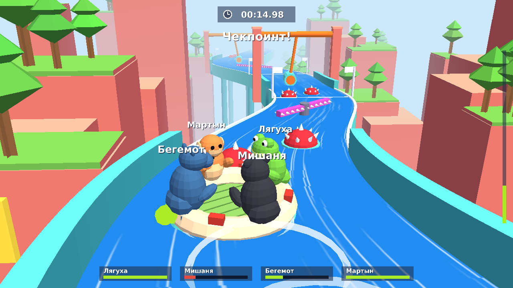

# Fart Together



Кооперативная 3D-аркада для ПК: четыре зверя на надувном плоту несутся по водной горке.
Плот двигается только газом: зверь пукает, и плот летит в противоположную от него сторону.
Плот крутится, так что кто сейчас «спереди», всё время меняется.

Цель: доплыть до финиша как можно быстрее. Там, где нет бортиков, можно вылететь с горки
(+3 секунды и возврат на чекпоинт). Мешают качающиеся молоты, крутящиеся шипастые палки и морские мины.

## Запуск

**Windows, без Python:** вкладка **Actions** → последний запуск → артефакт `FartTogether-windows`.
Распакуй архив целиком и запусти `FartTogether.exe`.

**Из исходников** (Python 3.9+, движок [Panda3D](https://www.panda3d.org/)):

```
pip install -r requirements.txt
python fart_together.py
```

Собрать `.exe` самому: `build_exe.bat` (или `python setup.py build_apps`).

Файлы: `sim.py` — физика и трасса, `gfx.py` — 3D-модели (всё строится кодом, без внешних моделей),
`net.py` — сеть, `fart_together.py` — игра, камера, интерфейс.
Шрифт DejaVu Sans (`assets/`), лицензия в `assets/DejaVu-LICENSE.txt`.

## Управление

| Режим | Клавиши |
|---|---|
| 1 — Соло | Стрелки / WASD: нужные звери пукают сами, чтобы толкнуть плот в эту сторону |
| 2 — Вместе (до 4 игроков за одной клавиатурой) | Лягуха **Q**, Мишаня **P**, Бегемот **Z**, Мартын **M** |
| 3 / 4 — Онлайн (до 4 игроков на разных ПК) | **Пробел**: пукает твой зверь |

У каждого зверя ограниченный запас газа (полоска внизу), он восстанавливается, пока зверь отдыхает.
`Esc` — пауза, `R` в паузе — заново. Лучшее время сохраняется в `~/.fart_together.json`.

## Онлайн

Один игрок создаёт игру (**3**), остальные подключаются (**4**) и вводят его адрес. До 4 игроков,
у каждого свой зверь. Хост считает физику, остальные присылают только свои нажатия, поэтому
отдельный сервер не нужен. Используется TCP-порт **5555**.

1. Хост жмёт **3**. На экране появятся его адреса, например `192.168.1.5:5555`.
2. Друзья жмут **4**, вводят адрес и Enter.
3. Когда все подключились, хост жмёт **Enter**.

Windows при первом запуске хоста спросит про брандмауэр: нужно разрешить доступ.

**Как подключиться через интернет.** Если вы не в одной Wi-Fi сети, проще всего поставить всем
бесплатную виртуальную сеть: [Radmin VPN](https://www.radmin-vpn.com/ru/) или
[ZeroTier](https://www.zerotier.com/). Создайте там общую сеть, хост создаёт игру, а друзья вводят его
адрес из Radmin/ZeroTier (например `26.12.34.56`).
Другие варианты:
- проброс порта 5555 на роутере хоста (друзья вводят его внешний IP);
- туннель [playit.gg](https://playit.gg) для TCP 5555 (друзья вводят выданный адрес вида `xxx.playit.gg:12345`).
